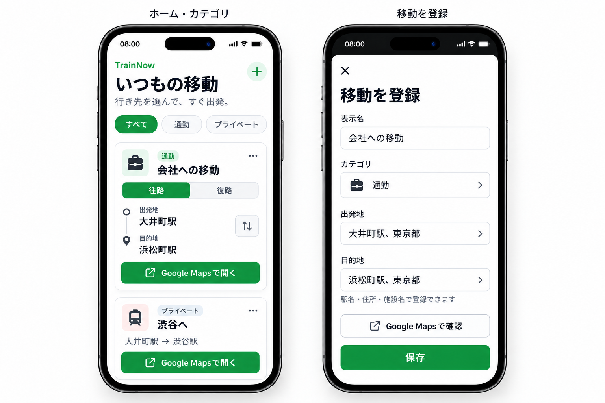
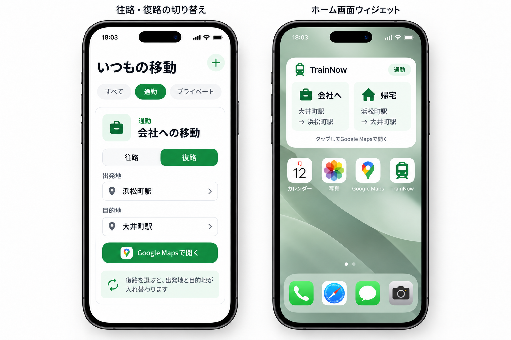

# RouteTap — MVP設計

作成日：2026-10-14  
更新日：2026-11-16
目標：2026-12-01までのiOS版公開を目指し、早めに審査へ提出する。承認・公開日は審査状況による。

## 1. コンセプトと採用方針

> いつもの移動を登録して、出発地・目的地を入力し直さずGoogle Mapsで経路を確認する。

※ 当初は認証とGo API・PostgreSQLによるサーバー保存を予定していたが、初版のリリースを最優先とし、iOSのみで完結する端末保存へ変更する。認証・バックアップは次版以降に検討する。

RouteTapは移動の保存・呼び出しを担当し、経路検索・電車時刻の表示はGoogle Mapsで行う。
ODPTや有料の経路検索APIは使用しない。

```text
初回：アプリを開く → 移動を登録 → iPhone内に保存
日常：一覧・ウィジェットから移動を選ぶ → Google Mapsで経路を確認
```

## 2. 初版の機能

| 機能 | 内容 |
| --- | --- |
| トップ画面 | ログインなしで保存した移動をカード一覧に表示する。 |
| 登録・編集・削除 | 表示名・出発地・目的地を端末に保存する。場所は自由入力。 |
| 往路・復路の切り替え | 出発地・目的地を反転して検索する。 |
| Google Maps連携 | 公共交通の経路検索URLを生成して開く。 |
| ホーム画面ウィジェット | 選択した移動の往路・復路を、アプリ経由でGoogle Mapsへ渡す。 |

## 3. 画面イメージ





参考画像に認証・アカウント管理の表示が含まれる場合も、初版には含めない。

## 4. 技術とデータの流れ

| 技術 | 役割 |
| --- | --- |
| Swift / SwiftUI | 一覧・入力・往復切り替え・Google Mapsの起動。 |
| App Groups・JSONファイル | アプリとウィジェットが共通で読む、端末内の保存場所。 |
| WidgetKit / App Intents | 移動の選択・表示・往復の呼び出し。 |

```text
アプリで登録・編集・削除
   ↓ 保存成功後に一覧を更新・ウィジェットへ更新要求
App Groups内のJSONファイル
   ├─ アプリが読み込む
   └─ ウィジェットが読み込む

一覧・ウィジェットから移動を選ぶ
   ↓
保存した2地点からURLを生成
   ↓
Google Mapsで検索
```

Go API・Neonは初版のアプリから利用しない。未使用のAPIコードとAPI用CIはリポジトリから削除し、必要になった場合はGit履歴から復元する。GCP・Neon上のリソースやデータは、このコード削除では変更しない。
端末保存では登録・編集・削除にネット接続は不要。Google Mapsでの経路検索には通信が必要。

## 5. 保存データとエラー処理

```text
SavedRoute
 ├─ ID（UUID）
 ├─ 表示名
 ├─ 出発地の検索文字列
 └─ 目的地の検索文字列
```

- ユーザーIDは持たず、端末内で一意なIDを維持する。
- JSONはバージョン付きで保存し、書き込みはファイルを置き換える方式で行う。
- 保存に成功するまで、画面上の保存済み一覧を変更しない。
- 読み込みに失敗した場合、空データとして扱わず、既存ファイルも上書きしない。
- 保存ファイルには端末のデータ保護を設定する。起動後初回の端末ロック解除前など、読み込めない状態はエラーとして扱う。
- 独自のサーバーバックアップ・別端末同期・サーバーからの復元は提供しない。
- アプリ削除・端末故障などで保存データが失われる可能性がある。OSのバックアップからの復元は保証しない。

## 6. Google Maps連携・ウィジェット

- 出発地・目的地・公共交通の指定をURLで渡し、日本語・空白・記号をエンコードする。
- URLの2,048文字制限を超えた場合はエラーを表示する。
- 地図アプリがない場合のブラウザ遷移、URLを開けない場合を確認する。
- RouteTap内ではGoogle Mapsの経路・発着時刻を取得しない。
- ウィジェットはログイン不要。アプリと同じ保存ファイルを読む。
- タップ時は最新の保存内容を読み、編集前の場所を開かない。
- ウィジェットのリンク形式が不正な場合や、指定された移動が存在しない場合は、Google Mapsを開かず、移動の再選択を案内する。
- 更新要求とOSによる表示更新は異なるため、即時更新を保証しない。

## 7. 初版の完成条件・実機確認

- 起動時にログイン確認を行わず、直接ルート一覧を表示する。
- オフラインでルートを登録・編集・削除できる。
- アプリを終了・再起動しても、同じID・内容のルートを読み込める。
- 一覧と往復表示、Google Mapsへ渡す出発地・目的地が一致する。
- ウィジェットで移動を選択でき、往路・復路を開ける。
- 編集・削除をウィジェットへ反映し、削除済みの移動を開かない。
- 保存・読み込み失敗を表示し、既存データを壊さない。

実機確認では開発用APIを停止し、機内モードで保存・再起動を確認する。
Google Mapsへの遷移は通信を戻して確認する。
旧認証版のサーバールート・キャッシュは移行せず、一覧は新しい端末保存として開始する。
既存ウィジェットは、端末にルートを登録した後で移動を選び直す。

## 8. 初版に含めないこと・別チケット

- 認証・アカウント管理・Go APIへの通信。
- サーバーデータ移行・バックアップ・端末間同期。
- カテゴリ分け・保存ルートの検索画面・場所の自動補完。
- ODPT時刻表・自前の経路計算・徒歩時間による乗車可否判定。
- 曜日・時間帯による優先表示・現在地発・移動共有・Web版。

公開用資料、プライバシーポリシーの導線、制約準拠の評価資料、TestFlight配布・審査提出は別チケットで対応する。
Cloud Runの一般公開停止も別作業として確認する。
