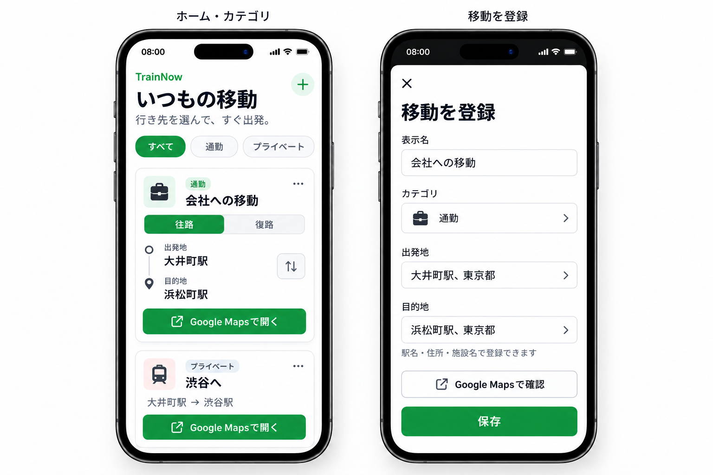
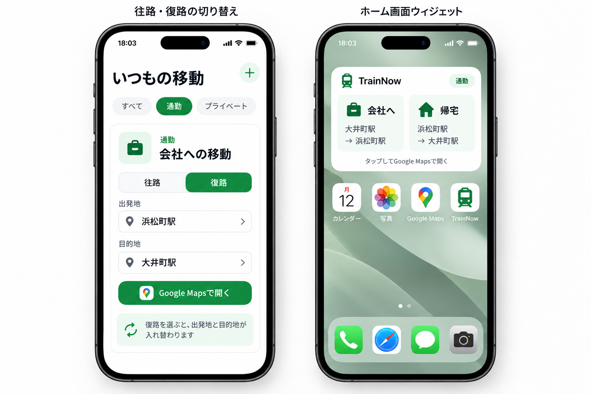

# RouteTap — MVP設計

作成日：2026-10-14  
更新日：2026-10-18  
目標：開発開始から1か月半以内にiOS版をリリースし、制約準拠の設計・実装・検証記録を整える。

## 1. コンセプトと採用方針

> いつもの移動を登録して、出発地・目的地を入力し直さずGoogle Mapsで経路を確認する。

初版からSwift・Go・PostgreSQLを使う。認証とユーザー別のサーバー保存を含め、バックエンドの設計・実装も行う。

RouteTapは移動の登録・整理・呼び出しを担当し、経路検索と電車時刻の表示はGoogle Maps側で行う。ODPTや有料の経路検索APIを初版の前提にしない。

```text
初回：新規登録・ログイン → 移動を登録
日常：保存した移動を選ぶ → Google Mapsで経路・電車時刻を確認
```

Google MapsへのURL連携は実機で確認済み。iOSアプリ本体・認証・サーバー保存・ウィジェットはこれから実装する。

## 2. 初版の機能

| 機能 | 内容 |
| --- | --- |
| 新規登録・ログイン | メールアドレスとパスワードで認証し、本人の保存データを扱う。 |
| トップ画面 | 保存した移動をカード一覧で表示する。 |
| 移動の登録・編集・削除 | 表示名・出発地・目的地を保存する。 |
| 往路・復路の切り替え | 保存した出発地・目的地を反転して経路検索を開く。 |
| Google Maps連携 | 公共交通の経路検索URLをSwiftで生成して開く。 |
| ホーム画面ウィジェット | 選択した移動の往路・復路を呼び出せる入口を用意する。 |
| アカウント管理 | ログアウトと、アカウント・保存データの削除ができる。 |

保存した移動はトップ画面のカード一覧から選ぶ。場所の登録は自由入力を基本にする。

## 3. 画面イメージ






## 4. 技術ごとの役割

| 技術 | 役割 |
| --- | --- |
| Swift / SwiftUI | 画面、入力、一覧表示、往復切り替え、URL生成、API通信、端末内保存。 |
| WidgetKit・共有領域 | 選択した移動をウィジェットに表示し、アプリ経由の遷移を含めてGoogle Mapsを開く動作を検証する。 |
| Go / Echo | 認証、入力検証、本人確認・所有権確認、移動のCRUD API。 |
| PostgreSQL | ユーザー、移動、認証方式に応じたセッション情報の永続保存。 |

```text
iOSアプリ（Swift）
   ↕ HTTPS
Go API（Echo）
   ↕
PostgreSQL

Goから取得した本人のデータ
   ↓
iPhone内のキャッシュ・共有領域
   ├─ アプリの一覧表示
   └─ ホーム画面ウィジェット

アプリ・ウィジェットの操作
   ↓
保存済み2地点からURLを生成
   ↓
Google Mapsで検索
```

Google Mapsの起動にGoを経由する必要はない。GoとDBはユーザー別の保存・復元と将来のWeb連携の基盤として使う。

## 5. 保存データの案

```text
User
 └─ SavedRoute
      ├─ 所有ユーザーID
      ├─ 表示名
      ├─ 出発地の検索文字列
      ├─ 目的地の検索文字列
      ├─ 作成日時
      └─ 更新日時
```

- 各データに安定したIDを付ける。
- 初版は移動の中に場所文字列を保存する。独立した場所マスタ、施設検索、端末間の高度な同期は後続で検討する。
- 所有者は認証情報からGo側で判定する。他人の移動を参照・更新・削除できないようにする。
- DB変更はマイグレーションで管理する。バックアップ・復元と運用費用もリリース前に確認する。

## 6. 認証と端末内キャッシュ

認証方式はメールアドレス＋パスワードを基本とし、パスワードのハッシュ化、トークン・セッションの方式、期限、失効を詳細設計する。認証情報はKeychain等の適切な保管先で管理し、ウィジェット用データへ混在させない。パスワード再設定は初版に含めない。

初版のデータ更新はオンラインを前提にする。

1. ログイン後、Goから本人の移動を取得する。
2. 取得データを端末にも保存し、アプリとウィジェットで使う。
3. 登録・編集・削除はGoで成功した後に端末内データへ反映する。
4. 通信失敗時は未保存であることを表示し、保存済みと誤認させない。
5. キャッシュだけを表示する場合は状態を区別する。
6. ログアウト・アカウント削除時は本人のキャッシュを消し、ウィジェットも未ログイン表示へ更新する。
7. 別アカウントへ切り替えても、前の利用者のデータを表示しない。

オフライン編集の後送信、複数端末の競合解決、リアルタイム同期は初版から外す。認証期限切れ時にキャッシュ閲覧・移動起動をどこまで許すかは詳細設計で決める。

## 7. Google Maps連携・ウィジェット

- Google Maps URLsに出発地・目的地・公共交通の指定を渡す。APIキーを使う経路データ取得は行わない。
- 日本語、空白、記号をURLとして正しくエンコードする。
- Google Maps内の経路検索結果・発着時刻をRouteTapへ取り込まない。
- 同名の場所があるため、住所・地域を含めた入力と任意の確認操作を用意する。
- Google Mapsがある場合・ない場合、URLが開けない場合を実機で確認する。
- ウィジェットは最後に取得した登録データを使う。タップのたびにサーバー取得を必須にしない。
- ウィジェットからの起動、往復指定、削除済み移動のタップ、ログアウト後の表示を検証する。
- 登録変更後の更新要求とOSによる表示更新を区別し、常時即時更新を前提にしない。


## 8. 1か月半の進め方（約6週間の目安）

| 期間 | 到達目標 |
| --- | --- |
| 1週目 | データ・API・画面・認証の設計。ウィジェットとURL遷移を小さく実機検証。 |
| 2週目 | Go・PostgreSQL接続、認証、本人の移動CRUDを実装。 |
| 3週目 | Swiftのログイン・登録・一覧をAPIと接続。 |
| 4週目 | 往復切り替え、端末キャッシュ・ウィジェット、編集・削除を仕上げる。 |
| 5週目 | 実機・権限・通信失敗の検証、アカウント管理、プライバシー・制約対応、配布・申請準備。 |
| 6週目 | 不具合・審査対応。公開と制約準拠の成果物を整える。 |

## 9. 初版の完成条件

- 新規登録・ログイン・ログアウト・アカウント削除が動く。アカウント削除では本人の保存データも削除する。
- 本人の移動だけを保存・取得・編集・削除できる。
- 保存した移動をトップ画面のカード一覧から選べる。
- 往復の表示とURLの出発地・目的地が一致する。
- 登録確認は任意で、そのまま保存できる。
- アプリ・ウィジェットから意図した2地点のGoogle Maps検索を開ける。
- 保存失敗、キャッシュ、ログアウト・アカウント切り替えを適切に扱う。
- サーバー・DBを配備し、実機で一連の操作を確認する。
- 制約への対処と検証結果、リリース手順を記録する。

## 11. 初版に含めないこと

- カテゴリ分け・カテゴリ管理・カテゴリによる絞り込み。
- 保存した移動を文字列で検索する画面・機能。
- パスワード再設定。
- ODPT時刻表の取得、RouteTap内の電車時刻・運賃・乗換結果の表示。
- 自前の経路計算、徒歩時間・余裕時間による乗車可否判定。
- 外部の場所検索・自動補完API。
- 曜日・時間帯による優先表示、現在地発、複数地図サービスの選択。
- 移動共有・Web版。
- オフライン編集の同期、複数端末間の競合解決。

